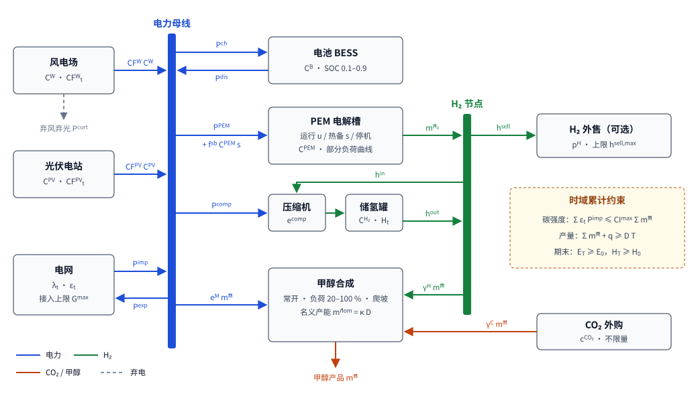

# Flexible power-to-methanol scheduling MILP (GAMSPy)

Hourly mixed-integer linear scheduling model for a wind- and PV-powered power-to-methanol (PtM) plant with bidirectional grid exchange, a battery (BESS) and a compressed-hydrogen buffer, written in [GAMSPy](https://gamspy.readthedocs.io).

The model is the operational layer of a design-under-uncertainty study. Installed capacities are inputs, and the model returns the cost-optimal hourly dispatch with full knowledge of the horizon (perfect foresight).

**Full documentation** (system diagram, assumptions, all equations, parameter sources): [`docs/MILP_model.md`](docs/MILP_model.md) (in Chinese).



## Model scope

| Unit | Representation |
|---|---|
| Wind and PV | Capacity factor × installed capacity, with curtailment |
| Grid | Import and export up to the connection limit at the day-ahead price; no grid carbon tax (power generation is under the EU ETS) |
| BESS | Energy balance with charge/discharge efficiency, self-discharge, SOC window and C-rate |
| PEM electrolyser | On / warm-standby / off states, minimum load, standby power and cold-start cost. The load-dependent specific energy consumption follows Chen & Yang (2021); the concave H₂ curve is represented exactly by its piecewise-linear upper envelope, without SOS2 binaries |
| H₂ tank | Inventory balance with compression power; optional H₂ sales |
| Methanol synthesis | Always on, modulating between 20 % and 100 % of nameplate with ramp limits (as in Mucci et al., 2023). Nameplate = κ × production requirement. An on/off unit-commitment variant is kept for sensitivity runs (`methanol_uc=True`) |
| Carbon rule | Grid-import emissions per tonne of methanol ≤ `CI_max`, with an hourly grid emission factor |
| Horizon end | End-of-horizon BESS and H₂ levels ≥ initial levels (optional) |

### Differences from the MasCOR operational model

The examples reuse the scenarios and designs of MasCOR (Kim et al., 2026). That model is wind-only and keeps methanol synthesis at constant nameplate load. This model adds or changes the following:

- PV generation and explicit curtailment; the grid-direction binaries are dropped.
- Flexible methanol synthesis, with a production requirement and an oversizing factor κ.
- Electrolyser on/standby/off states with a load-dependent efficiency.
- Hourly grid emission factors from Energinet instead of a constant 0.5 tCO₂/MWh, and no national carbon tax on grid imports.
- Negative electricity prices are kept rather than clipped at zero.

## Installation

```bash
pip install -r requirements.txt
```

The example instances (15k–237k equations) exceed GAMSPy's size limits without a license. Academic licenses are free from GAMS. The default solver is CPLEX; pass `solver=` to `solve()` to use another MIP solver.

## Quick start (synthetic data)

```python
import numpy as np
from ptm_scheduling_gamspy import (
    OperatingParams, PlantDesign, SchedulingData,
    build_model, hourly_results, kpis, solve,
)

rng = np.random.default_rng(0)
n = 168
data = SchedulingData.from_arrays(
    cf_wind=rng.uniform(0, 1, n), price=rng.uniform(0, 100, n), eps_grid=0.1, cf_pv=rng.uniform(0, 0.5, n)
)
design = PlantDesign(C_PV_MW=25.0, m_MeOH_nom_kgph=1250.0, D_MeOH_kgph=1000.0)
par = OperatingParams()

m, model, relaxed, symbols = build_model(data, design, par)
wall_s, _ = solve(model)
print(model.objective_value, kpis(hourly_results(data, design, par, symbols), design, par))
```

## Examples

`run_ptm_examples.py` solves three cases:

1. A 576-h synthetic scenario for Skive (Denmark) using the MasCOR-sampled design, wind only, κ = 1.
2. The same scenario with κ = 1.25.
3. The historical year 2023 at Skive (8760 h), wind + PV, hourly DK1 emission factor, demonstration design with κ = 1.25.

To run them:

1. Download the `dataset/` folder (about 4.5 GB) of the [MasCOR Kaggle dataset](https://www.kaggle.com/datasets/jeongdongkim/dataset-for-mascor-framework).
2. Point `MASCOR_DATASET` at it:

   ```bash
   export MASCOR_DATASET=/path/to/dataset   # PowerShell: $env:MASCOR_DATASET="C:\path\to\dataset"
   python run_ptm_examples.py
   ```

On the first run, two public series are downloaded and cached in `data/`:
- **PV capacity factor**: [PVGIS v5.3](https://re.jrc.ec.europa.eu/pvg_tools/en/) (EU JRC), SARAH3 radiation, 1 kWp c-Si, optimal fixed tilt, 14 % system loss.
- **Grid emission factor**: [Energinet Declaration Grid Emission](https://www.energidataservice.dk/tso-electricity/DeclarationGridEmission), DK1, 125 % CHP allocation, fossil CO₂.

Hourly results and a summary are written to `results/`.

Reference solve times (CPLEX, default threads, 0.5 % relative gap):

| Case | Horizon | Equations | MILP | LP relaxation |
|---|---|---|---|---|
| Skive scenario 0, κ = 1 | 576 h | 15,557 | 0.7 s | 0.2 s |
| Skive scenario 0, κ = 1.25 | 576 h | 15,557 | 2.0 s | 0.3 s |
| Skive 2023, wind + PV | 8760 h | 236,525 | 75 s | 11 s |

## Status and limitations

- **Single-source parameters.** The methanol synthesis electricity use and H₂/CO₂ consumption come from one source (via MasCOR). The on/off variant's start-up parameters are placeholders.
- **PEM curve.** The default curve, linear in load (Chen & Yang, 2021), is optimistic at low load. `PEM_CURVE_BOP_PEAK` is provided as a sensitivity case.
- **Synthetic scenarios.** The MasCOR scenarios have no PV and no timestamps, so they use a constant emission factor (DK1 2023 mean).
- **Carbon rule.** `CI_max` reproduces MasCOR's net-negative rule. It is not a regulatory threshold, and with Danish grid intensities it does not bind in the examples.
- **Single-horizon model.** The cumulative constraints apply within one horizon only, so the model is not yet set up for rolling-horizon use.
- **BESS at negative prices.** At negative prices the battery may charge and discharge in the same hour to dissipate energy. Set `bess_exclusive=True` to prevent this.

## Units

Time is in h; power in MW; electrical energy in MWh; H₂ and methanol flows in kg/h; H₂ inventory in kg; prices in USD/MWh; emission factors in tCO₂/MWh.

## References

- Kim, J. et al. (2026). Optimal trajectory-guided stochastic co-optimization for e-fuel system design and real-time operation (MasCOR). arXiv:2603.03484. Code: https://github.com/PSEKJD/mascor
- Chen, C., Yang, A. (2021). Power-to-methanol: the role of process flexibility in the integration of variable renewable energy into chemical production. Energy Convers. Manag. 228, 113673.
- Mucci, S., Mitsos, A., Bongartz, D. (2023). Cost-optimal power-to-methanol: flexible operation or intermediate storage? arXiv:2305.18338.

See `docs/MILP_model.md` for the full list of parameter sources.

## License

MIT
