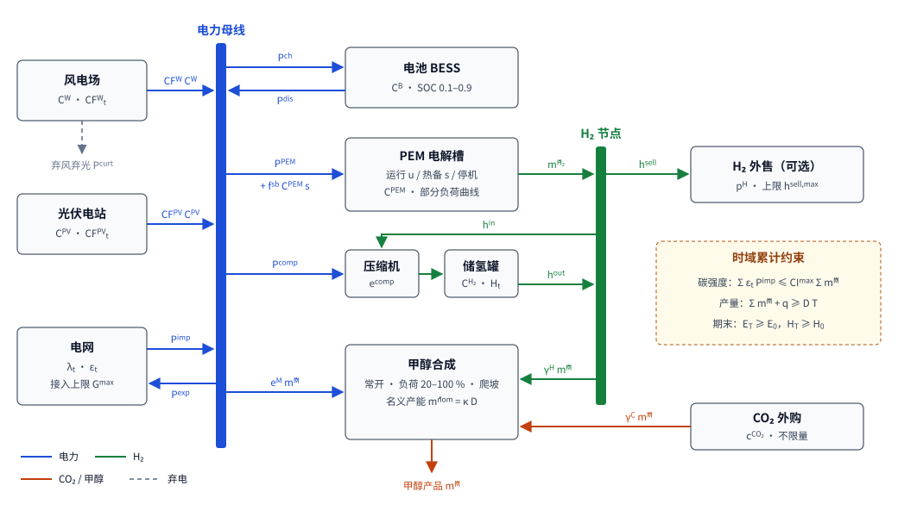

# 电转甲醇（PtM）调度 MILP 模型说明

> 对应代码：[`ptm_scheduling_gamspy.py`](../ptm_scheduling_gamspy.py) 中的 `build_model()` 和 `add_downstream_section()`，以及算例脚本 [`run_ptm_examples.py`](../run_ptm_examples.py)、[`run_fvc_examples.py`](../run_fvc_examples.py)、[`validate_fvc_part1.py`](../validate_fvc_part1.py)。参数默认值以 `OperatingParams` 和 `PlantDesign` 为准。本文与代码不一致时以代码为准，并同步修改本文。
>
> **怎么看公式**：公式用 LaTeX 书写。在 VS Code 里打开本文件后按 `Ctrl+Shift+V`（或点右上角的预览按钮）即可渲染成正常公式；GitHub 网页上也会直接渲染。要粘进 Word，可以在 Word 公式框里切换到 LaTeX 输入模式。

---

## 1 系统与用途

**系统边界**
- 风电和光伏接入电力母线，母线与电网双向交换电力，电池挂在母线上。
- PEM 电解槽产出的 H₂ 进入 H₂ 节点。从节点出发，H₂ 有三个去处：直接送甲醇合成；经压缩进储氢罐，需要时再放回节点；可选地外售。
- CO₂ 全部外购。
- 图中蓝线是电力流，绿线是 H₂ 流，橙线是 CO₂ 和甲醇；箭头旁标注的是对应的模型变量。

**用途**：给定装机容量，求时域内（576 h 或 8760 h）逐小时的成本最优调度。

**基准情景与敏感性情景**

| 项目 | 基准情景（默认） | 敏感性情景（代码开关） |
|---|---|---|
| 甲醇合成 | 常开，负荷在 20–100 % 之间调（Mucci 等 2023 的做法） | `methanol_uc=True`：开停机、最短开停机时间、启动成本，参数均为假设 |
| PEM 部分负荷曲线 | Chen & Yang (2021) 线性比能耗 | `pem_curve=PEM_CURVE_BOP_PEAK`：系统效率在约 20 % 负荷时最高的假设曲线 |
| 电网碳税 | 不计 | `tax_CO2`（MasCOR 取 28.10 USD/t），仅用于复现 MasCOR |
| 电池充放电互斥 | 不加 | `bess_exclusive=True` |
| 精馏与下游 | 精馏能耗并入 $e^{\mathrm{M}}$，产量要求加在合成产量上 | `distillation="explicit"`：粗甲醇罐 + FVC 精馏 + 加压水储热罐（第 8.1 节） |
| 合成动态 | 恒定单耗、固定爬坡 | `syn_curve`、`ramp_MeOH_R1`、`alpha_up_H2`/`alpha_dn_H2`（第 8.2 节），参数待 Aspen Dynamics 标定 |
| 绿电匹配 | 不加 | `match_window_h` + `phi_import`/`phi_spill`（第 8.3 节） |

**当前角色**：在研究框架里，本模型目前只承担"完美预见上界"这一角色。以后会在它的基础上扩展出另外三个：滚动时域基线、RL 专家演示、设计 MILP（见第 9 节）。

---

## 2 建模假设

| 编号 | 假设 | 影响与说明 |
|---|---|---|
| A1 | **完美预见**：时域内风光出力、电价、排放因子全部已知 | 结果是理论上界，偏乐观 |
| A2 | 时间步长 $\Delta t = 1$ h，1 h 以内的动态不建模 | PEM 启动在秒到分钟级 [2,3]；甲醇反应器负荷变化速率为每分钟数个百分点 [7]，在小时尺度上可视为准稳态 [5] |
| A3 | 价格接受者，购电和售电都按同一个日前电价结算 | 不参与辅助服务市场；基准情景不计电网费 |
| A4 | **不计电网碳税** | 发电已纳入 EU ETS，ETS 成本已基本传导到日前电价中 [13]；各国碳税一般不针对已纳入 ETS 的发电（法国明确排除 ETS 行业 [12]）。再按国家碳税对购电排放收费属于重复计价 |
| A5 | 弃风弃光不产生成本，风光没有变动运维成本 | 弃电只是一个调度自由度 |
| A6 | PEM 用**系统级**比能耗，随负荷线性变化（Chen & Yang 2021 [4]，式 20） | 满负荷 55.7 kWh/kg。这条曲线在低负荷时偏乐观（见第 5 节），另设敏感性曲线 |
| A7 | PEM 热备用：不产氢，耗电为额定功率的 $f^{\mathrm{sb}}$。热备用→运行无成本；停机→运行（冷启动）按装机功率计成本 | 不建堆衰减 |
| A8 | 只有进罐的 H₂ 需要压缩，压缩比功耗为常数（压到 172 bar [4]），与罐压无关 | 直接送合成的 H₂ 不另计压缩功（沿用 MasCOR） |
| A9 | **甲醇合成常开**，负荷在 $f^{\mathrm{M}}$ 到 100 % 之间连续调节，有爬坡限制；不建开停机 | 启停过程缺乏可靠数据，Mucci 等 [5] 出于同样原因采用了这种做法。开停机版本作为敏感性 |
| A10 | 每 kg 甲醇的电耗、H₂ 耗、CO₂ 耗不随负荷变化 | 部分负荷下合成效率不变；精馏能耗并入 $e^{\mathrm{M}}$。`distillation="explicit"` 时精馏单独建模（第 8.1 节），$e^{\mathrm{M}}$ 仍取 0.657，视作合成回路电耗（假设，待 Aspen 拆分）；部分负荷图见第 8.2 节 |
| A11 | **产量要求**按平均速率 $D$ 给出，名义产能 $\dot m^{\mathrm{nom}} = \kappa D$（$\kappa \ge 1$ 为超配系数）；软约束，缺额罚款 | 与 Chen & Yang [4] 一致：固定产量、超配装置以换取柔性。$\kappa = 1$ 时甲醇只能满负荷运行，即退化为 MasCOR 的刚性装置 |
| A12 | CO₂ 供应不限量、价格固定，不设 CO₂ 储存 | — |
| A13 | 电网排放只计购电（基于位置的核算），售电不抵扣；排放因子取 Energinet 逐时数据中的化石 CO₂（125 % 热电联产分摊法），不计 CH₄、N₂O | — |
| A14 | 碳规则：时域内累计购电排放 ≤ $CI^{\max}$ × 甲醇产量 | 沿用 MasCOR 的"净负排放"规则，**不是法规值**；欧盟 RFNBO 的判定方法不同（见第 3.4 节） |
| A15 | 初始状态给定；时域末储能不低于初值 | 滚动时域使用前需要修改（见第 9 节） |
| A16 | 电池不建衰减，默认不加充放电互斥变量 | 负电价或零电价时电池可能同时充放电 |
| A17 | 不计氧气副产、余热回收、用水约束；目标函数不含投资（CAPEX） | 只算运行成本，LCOM 在设计层计算 |
| A18 | 两个平局打破项：PEM 功率 0.01 USD/MWh，电网购电和售电各 0.01 USD/MWh | 只用于在零电价时消除多重最优解，对经济性的影响可以忽略（见第 5、6 节） |

---

## 3 符号与参数

### 3.1 集合

| 符号 | 代码 | 含义 |
|---|---|---|
| $\mathcal{T} = \lbrace 1, \dots, T \rbrace$ | `t` | 小时 |
| $\mathcal{K}$ | `k` | PEM 部分负荷曲线的分段（默认 4 段） |

### 3.2 外生输入（逐小时）

| 符号 | 代码 | 单位 | 来源 |
|---|---|---|---|
| $CF^{\mathrm{W}}_t$ | `cf` | – | 风速经 MasCOR 风机功率曲线换算：切入 1.5 m/s，额定 12 m/s，切出 25 m/s，切入到额定之间按三次方 [1] |
| $CF^{\mathrm{PV}}_t$ | `cf_pv` | – | PVGIS v5.3 [16]：SARAH3 辐照 + ERA5 气象，1 kWp 晶硅，最佳固定倾角和方位，系统损失 14 %。Skive 2023 年平均 0.108 |
| $\lambda_t$ | `price` | USD/MWh | MasCOR 场景：原值 ×1000（USD/kWh → USD/MWh），负电价已被 MasCOR 截为 0。历史年：Ember 日前电价 ×1.03（EUR → USD），**保留负电价** |
| $\varepsilon_t$ | `eps_g` | tCO₂/MWh | Energinet "Declaration Grid Emission" [15]，DK1，125 % 分摊法，字段 `CO2PerkWh`。DK1 2023 年平均 0.0997，范围 0.005–0.564 |

MasCOR 的合成场景没有时间戳，也没有光伏：这类算例取 $C^{\mathrm{PV}} = 0$，$\varepsilon_t$ 取 DK1 2023 年平均值（常数）。

数据在第一次运行时下载，并缓存到 `data/` 目录（不纳入 git）。

### 3.3 设计参数（装机与产量要求）

| 符号 | 代码 | 单位 | 演示设计（2023 全年） | MasCOR 算例 |
|---|---|---|---|---|
| $C^{\mathrm{W}}$ | `C_wind_MW` | MW | 50 | 50 |
| $C^{\mathrm{PV}}$ | `C_PV_MW` | MW | 25 | 0 |
| $C^{\mathrm{PEM}}$ | `C_PEM_MW` | MW | 20 | 按 MasCOR 规则换算，见下 |
| $C^{\mathrm{B}}$ | `C_BESS_MWh` | MWh | 20 | `ESS-cap`/1000 |
| $C^{\mathrm{H_2}}$ | `C_H2_kg` | kg | 1000 | `LH2-cap` |
| $D$ | `D_MeOH_kgph` | kg/h | 1000 | `X-flow` |
| $\dot m^{\mathrm{nom}} = \kappa D$ | `m_MeOH_nom_kgph` | kg/h | 1250（$\kappa$ = 1.25） | $\kappa$ = 1 或 1.25 |
| $G^{\max}$ | `G_max_MW` | MW | 50 | 100 |

MasCOR 中 PEM 容量是和储罐大小绑定的。算例照搬这一换算，其中 $SEC^{\mathrm{rated}} = 55.7$ kWh/kg，$r^{\mathrm{PEM}}$ 是 MasCOR 设计向量里的 `PEM-ratio`：

$$
P^{\mathrm{PEM,min}} = 10^{-3}\,D\,\gamma^{\mathrm{H}}\,SEC^{\mathrm{rated}}, \qquad
P^{\mathrm{PEM,max}} = P^{\mathrm{PEM,min}} + 10^{-3}\,C^{\mathrm{H_2}}\,SEC^{\mathrm{rated}}
$$

$$
C^{\mathrm{PEM}} = P^{\mathrm{PEM,min}} + r^{\mathrm{PEM}}\left(P^{\mathrm{PEM,max}} - P^{\mathrm{PEM,min}}\right)
$$

本模型自身把 $C^{\mathrm{PEM}}$ 当作独立参数，上面的换算只用在复现 MasCOR 算例时。

### 3.4 运行与经济参数

"核对"一列：✅ 有正式来源；⚠ 单一来源，或有前提；❌ 没有正式来源（代码里标了 `ASSUMPTION`）。

| 符号 | 代码 | 默认值 | 单位 | 来源 | 核对 |
|---|---|---|---|---|---|
| **PEM 电解槽** | | | | | |
| $SEC(L)$ | `pem_curve` | $55.7 - (1-L)(55.7-39.4)$ | kWh/kg | Chen & Yang 2021 [4] 式 20 与补充表 15：55.7 为满负荷值，39.4 为负荷趋于 0 时的值。Clean Hydrogen JU 给出 PEM 现状值 55（2020）、52（2024）kWh/kg [9] | ✅（低负荷段偏乐观） |
| $f^{\min}$ | `f_min_PEM` | 0.10 | – | IEA 2019 电堆运行范围 0–160 %（经 [5] 引用）；Baumhof 等 2023 取 15 % [3]；Mucci 等受压缩机限制取 25 % [5] | ✅ |
| $f^{\mathrm{sb}}$ | `f_sb_PEM` | 0.02 | – | 文献范围 1–5 %（[3] 引 Matute 2021、Varela 2021）；≥ 400 kW 机组约 2 % [10] | ✅ |
| $c^{\mathrm{SU,P}}$ | `c_cold_start_PEM` | 51.5 | USD/(MW·次) | 50 €/MW × 1.03。Baumhof 等 2023：52.25 MW 一次 2612.5 €，出自 Varela 2021（碱性电解系统）[3] | ✅ |
| $c^{\mathrm{tb,P}}$ | `c_tiebreak_PEM` | 0.01 | USD/MWh | 数值技巧（A18） | — |
| **甲醇合成** | | | | | |
| $f^{\mathrm{M}}$ | `f_min_MeOH` | 0.20 | – | Mucci 等 2023 取 20–100 %，引 Dieterich 等 2020 [5,6]；绝热式和水冷式反应器 20–110 % [8]；合成回路最低约 20 %，受压缩机限制 [7]。Chen & Yang 假设 10 % [4] | ✅ |
| $R$ | `ramp_MeOH` | 0.50 | 1/h | Chen & Yang：限到 20 %/h 对 LCOM 几乎无影响 [4]；Mucci 等：超过 10 %/h 已无收益 [5]；动态模型 2–3 %/min [7] | ✅（小时尺度基本不起作用） |
| $e^{\mathrm{M}}$ | `SP_MeOH` | 0.65702 | kWh/kg | MasCOR Table S1，出自 Vo 等 2022 [1] | ⚠ 单一来源 |
| $\gamma^{\mathrm{H}}$ | `gamma_H2` | 0.19576 | kg/kg | MasCOR Table S1，出自 Vo 等 2022 [1]。化学计量值 0.1888，相当于 H₂ 利用率 96.4 % | ⚠ 自洽，单一来源 |
| $\gamma^{\mathrm{C}}$ | `gamma_CO2` | 1.435802 | kg/kg | 同上。化学计量值 1.3735，相当于碳利用率 95.7 % | ⚠ 自洽，单一来源 |
| $UT$, $DT$, $c^{\mathrm{SU,M}}$ | `UT_MeOH` 等 | 8 h, 4 h, 5000 USD | — | 只在开停机敏感性情景中使用。文献只给出冷启动需数小时、H₂ 热备用下 15–36 min [8] | ❌ |
| **H₂ 压缩与储存** | | | | | |
| $e^{\mathrm{comp}}$ | `SP_comp` | 3.03 | kWh/kg | Chen & Yang 2021 补充表 15（压到 172 bar，等熵效率 75 %）[4]。MasCOR Table S1 写成 3.003，是笔误 | ✅ |
| $f^{\mathrm{H,min}}$ | `f_min_H2` | 0 | – | 垫气比例，暂取 0 | — |
| **电池** | | | | | |
| $\eta^{\mathrm{ch}}$, $\eta^{\mathrm{dis}}$ | `eta_ch`, `eta_dis` | 0.95 | – | MasCOR Table S1，出自 Kang 等 2023 [1]；往返效率 90.25 %。Mucci 等引 IRENA 2017：锂电池往返效率约 95 % [5] | ✅ |
| $\sigma$ | `loss_BESS` | 6.94×10⁻⁵ | 1/h | MasCOR Table S1（每月 5 %）[1] | ✅ |
| $SOC^{\min}$, $SOC^{\max}$ | `soc_min`, `soc_max` | 0.10, 0.90 | – | MasCOR [1]；Mucci 等同样取最低 10 % [5] | ✅ |
| $\alpha$ | `c_rate` | 0.30 | 1/h | MasCOR Table S1 [1] | ✅ |
| **经济** | | | | | |
| $c^{\mathrm{fee}}$ | `grid_fee` | 0 | USD/MWh | 基准不计。丹麦输电网费可参考 Baumhof 等 2023 取 15.06 €/MWh [3] | — |
| $\tau^{\mathrm{C}}$ | `tax_CO2` | 0 | USD/tCO₂ | 见 A4。MasCOR Table S2 取 28.10（丹麦）、47.96（法国）、48.39（德国），出自 Tax Foundation 2024 [11] | ❌（MasCOR 的用法） |
| $c^{\mathrm{tb,G}}$ | `c_tiebreak_grid` | 0.01 | USD/MWh | 数值技巧（A18） | — |
| $c^{\mathrm{CO_2}}$ | `c_CO2_feed` | 50 | USD/t | MasCOR 代码，论文未给出处。捕集成本：乙醇厂 0–35、水泥 45–120、DAC 89–1000 USD/t [14] | ✅（对应工业或生物源） |
| $c^{\mathrm{w}}$ | `c_water_H2` | 0.1284 | USD/kg H₂ | MasCOR 代码，论文未给出处 | ⚠ 影响很小 |
| $p^{\mathrm{H}}$, $h^{\mathrm{sell,max}}$ | `p_H2_sale`, `H2_sale_max_kgph` | 0, 0 | USD/kg, kg/h | 默认关闭 H₂ 外售；MasCOR 取 5 USD/kg | — |
| $p^{\mathrm{M}}$ | `p_MeOH` | 0 | USD/t | 算例设定 | — |
| $c^{\mathrm{q}}$ | `c_short_MeOH` | 5000 | USD/t | 算例设定（罚款足够高，使缺额只在无解时出现） | — |
| $CI^{\max}$ | `CI_max` | 1.435802 | tCO₂/t | MasCOR 的净负排放规则 [1]。法规参照：欧盟 RFNBO 要求相对 94 gCO₂e/MJ 的化石基准减排 ≥ 70 % [17]，即全生命周期 ≤ 28.2 g/MJ，约合 0.56 t/t 甲醇（LHV 19.9 MJ/kg），口径与本约束不同 | ⚠ 非法规值 |
| **初始状态** | | | | | |
| $SOC_0$, $h_0$ | `soc0`, `h0` | 0.5, 0.5 | – | 算例设定（MasCOR 取 SOC 10 %、空罐） | — |
| $u_0$, $s_0$ | `u0_PEM`, `s0_PEM` | 1, 0 | – | 算例设定 | — |
| $\dot m^{\mathrm{M}}_0$ | `m0_MeOH_frac` | $D$ | kg/h | 默认从产量要求对应的负荷起步 | — |

### 3.5 决策变量

| 符号 | 代码 | 类型 | 单位 | 含义 |
|---|---|---|---|---|
| $P^{\mathrm{imp}}_t$, $P^{\mathrm{exp}}_t$ | `P_imp`, `P_exp` | 连续 ≥ 0 | MW | 购电、售电 |
| $P^{\mathrm{curt}}_t$ | `P_curt` | 连续 ≥ 0 | MW | 弃风弃光 |
| $P^{\mathrm{ch}}_t$, $P^{\mathrm{dis}}_t$ | `P_ch`, `P_dis` | 连续 ≥ 0 | MW | 电池充电、放电 |
| $E_t$ | `E` | 连续 ≥ 0 | MWh | 电池电量 |
| $P^{\mathrm{PEM}}_t$ | `P_PEM` | 连续 ≥ 0 | MW | PEM 运行功率（不含热备用功耗） |
| $P^{\mathrm{comp}}_t$ | `P_comp` | 连续 ≥ 0 | MW | H₂ 压缩功率 |
| $\dot m^{\mathrm{H_2}}_t$ | `m_H2` | 连续 ≥ 0 | kg/h | 产氢量 |
| $h^{\mathrm{in}}_t$, $h^{\mathrm{out}}_t$, $h^{\mathrm{sell}}_t$ | `h_in`, `h_out`, `h_sell` | 连续 ≥ 0 | kg/h | 进罐、出罐、外售 H₂ |
| $H_t$ | `H` | 连续 ≥ 0 | kg | 储罐存量 |
| $\dot m^{\mathrm{M}}_t$ | `m_M` | 连续 ≥ 0 | kg/h | 甲醇产量 |
| $q$ | `short` | 连续 ≥ 0 | t | 时域内的产量缺额 |
| $u_t$, $s_t$ | `u_P`, `s_P` | 0-1 | – | PEM 运行、热备用 |
| $y^{\mathrm{P}}_t$ | `y_P` | 连续 ∈ [0, 1] | – | PEM 冷启动。不必设为二进制：$u$、$s$ 已是整数，最小化目标会把它压到 0 或 1 |
| $z^{\mathrm{B}}_t$ | `z_B` | 0-1 | – | 电池充电模式（仅在 `bess_exclusive=True` 时存在） |

基准情景每小时只有 2 个二进制变量（$u_t$、$s_t$）。开停机敏感性情景另加 $v_t$、$y^{\mathrm{M}}_t$、$z^{\mathrm{M}}_t$（`u_M`、`y_M`、`z_M`）。

---

## 4 约束

以下所有约束都对 $\forall t \in \mathcal{T}$ 成立。下标 $t-1$ 在 $t = 1$ 时取初值。式中的 $10^{-3}$ 用于 kWh/kg × kg/h → MW，以及 kg → t 的换算。

### 4.1 电力母线（`eq_power`, `eq_curt`, `eq_imp_max`, `eq_exp_max`）

$$
CF^{\mathrm{W}}_t C^{\mathrm{W}} + CF^{\mathrm{PV}}_t C^{\mathrm{PV}} - P^{\mathrm{curt}}_t + P^{\mathrm{imp}}_t + P^{\mathrm{dis}}_t
= P^{\mathrm{exp}}_t + P^{\mathrm{ch}}_t + P^{\mathrm{PEM}}_t + f^{\mathrm{sb}} C^{\mathrm{PEM}} s_t + P^{\mathrm{comp}}_t + 10^{-3}\, e^{\mathrm{M}}\, \dot m^{\mathrm{M}}_t
\tag{1}
$$

$$
0 \le P^{\mathrm{curt}}_t \le CF^{\mathrm{W}}_t C^{\mathrm{W}} + CF^{\mathrm{PV}}_t C^{\mathrm{PV}} \tag{2}
$$

$$
0 \le P^{\mathrm{imp}}_t \le G^{\max}, \qquad 0 \le P^{\mathrm{exp}}_t \le G^{\max} \tag{3}
$$

不需要"买电/卖电互斥"的二进制变量：电价不为 0 时，同时买卖电在经济上不会更优；电价恰好为 0 时，由平局打破项排除（A18）。

### 4.2 电池（`eq_soc`, `eq_soc_min`, `eq_soc_max`, `eq_ch_max`, `eq_dis_max`）

$$
E_t = (1-\sigma)\,E_{t-1} + \left(\eta^{\mathrm{ch}} P^{\mathrm{ch}}_t - \frac{P^{\mathrm{dis}}_t}{\eta^{\mathrm{dis}}}\right)\Delta t, \qquad E_0 = SOC_0\, C^{\mathrm{B}} \tag{4}
$$

$$
SOC^{\min} C^{\mathrm{B}} \le E_t \le SOC^{\max} C^{\mathrm{B}} \tag{5}
$$

$$
0 \le P^{\mathrm{ch}}_t \le \alpha\, C^{\mathrm{B}}, \qquad 0 \le P^{\mathrm{dis}}_t \le \alpha\, C^{\mathrm{B}} \tag{6}
$$

如果设了 `bess_exclusive=True`，式 (6) 改为：

$$
P^{\mathrm{ch}}_t \le \alpha\, C^{\mathrm{B}} z^{\mathrm{B}}_t, \qquad P^{\mathrm{dis}}_t \le \alpha\, C^{\mathrm{B}} \left(1 - z^{\mathrm{B}}_t\right) \tag{6'}
$$

### 4.3 PEM 电解槽（`eq_pem_state`, `eq_pem_min`, `eq_pem_max`, `eq_pem_cold`, `eq_pem_curve`）

$$
u_t + s_t \le 1 \tag{7}
$$

$$
f^{\min} C^{\mathrm{PEM}} u_t \le P^{\mathrm{PEM}}_t \le C^{\mathrm{PEM}} u_t \tag{8}
$$

$$
y^{\mathrm{P}}_t \ge u_t - u_{t-1} - s_{t-1}, \qquad 0 \le y^{\mathrm{P}}_t \le 1 \tag{9}
$$

$$
\dot m^{\mathrm{H_2}}_t \le a_k\, P^{\mathrm{PEM}}_t + b_k\, C^{\mathrm{PEM}} u_t, \qquad \forall k \in \mathcal{K} \tag{10}
$$

- **三种状态**：$u = 1$ 为运行；$s = 1$ 为热备用；两者都为 0 为停机。
- **冷启动**：只有从停机直接转到运行时，$y^{\mathrm{P}}_t$ 才被强制为 1；从热备用转到运行不计成本。
- **系数** $a_k$、$b_k$ 的推导见第 5 节。

### 4.4 H₂ 节点与储罐（`eq_h2_node`, `eq_tank`, `eq_tank_min`, `eq_tank_max`, `eq_comp`, `eq_sell_max`）

$$
\dot m^{\mathrm{H_2}}_t + h^{\mathrm{out}}_t = \gamma^{\mathrm{H}}\, \dot m^{\mathrm{M}}_t + h^{\mathrm{in}}_t + h^{\mathrm{sell}}_t \tag{11}
$$

$$
H_t = H_{t-1} + \left(h^{\mathrm{in}}_t - h^{\mathrm{out}}_t\right)\Delta t, \qquad H_0 = h_0\, C^{\mathrm{H_2}} \tag{12}
$$

$$
f^{\mathrm{H,min}} C^{\mathrm{H_2}} \le H_t \le C^{\mathrm{H_2}} \tag{13}
$$

$$
P^{\mathrm{comp}}_t = 10^{-3}\, e^{\mathrm{comp}}\, h^{\mathrm{in}}_t \tag{14}
$$

$$
0 \le h^{\mathrm{sell}}_t \le h^{\mathrm{sell,max}} \tag{15}
$$

### 4.5 甲醇合成（`eq_m_min`, `eq_m_max`, `eq_m_ramp_up`, `eq_m_ramp_dn`）

基准情景，装置常开：

$$
f^{\mathrm{M}}\, \dot m^{\mathrm{nom}} \le \dot m^{\mathrm{M}}_t \le \dot m^{\mathrm{nom}} \tag{16}
$$

$$
\left|\, \dot m^{\mathrm{M}}_t - \dot m^{\mathrm{M}}_{t-1} \right| \le R\, \dot m^{\mathrm{nom}} \Delta t \tag{17}
$$

式 (17) 在代码里拆成上爬坡、下爬坡两条线性约束。

**开停机敏感性情景**（`methanol_uc=True`）：式 (16)、(17) 换成下面这组。其中 $v_t$ 为运行状态，$y^{\mathrm{M}}_t$、$z^{\mathrm{M}}_t$ 为启动和停机：

$$
f^{\mathrm{M}} \dot m^{\mathrm{nom}} v_t \le \dot m^{\mathrm{M}}_t \le \dot m^{\mathrm{nom}} v_t, \qquad v_t - v_{t-1} = y^{\mathrm{M}}_t - z^{\mathrm{M}}_t, \qquad y^{\mathrm{M}}_t + z^{\mathrm{M}}_t \le 1 \tag{16'}
$$

$$
\dot m^{\mathrm{M}}_t - \dot m^{\mathrm{M}}_{t-1} \le R\, \dot m^{\mathrm{nom}} \Delta t + f^{\mathrm{M}} \dot m^{\mathrm{nom}} y^{\mathrm{M}}_t, \qquad
\dot m^{\mathrm{M}}_{t-1} - \dot m^{\mathrm{M}}_t \le R\, \dot m^{\mathrm{nom}} \Delta t + f^{\mathrm{M}} \dot m^{\mathrm{nom}} z^{\mathrm{M}}_t \tag{17'}
$$

$$
\sum_{\tau=\max(1,\; t-UT+1)}^{t} y^{\mathrm{M}}_\tau \le v_t, \qquad \sum_{\tau=\max(1,\; t-DT+1)}^{t} z^{\mathrm{M}}_\tau \le 1 - v_t \tag{18'}
$$

此时目标函数另加启动成本 $c^{\mathrm{SU,M}} \sum_t y^{\mathrm{M}}_t$。

### 4.6 产量要求与碳强度约束（`eq_target`, `eq_ci`）

$$
10^{-3} \sum_{t \in \mathcal{T}} \dot m^{\mathrm{M}}_t\, \Delta t + q \;\ge\; 10^{-3}\, D\, T\, \Delta t \tag{18}
$$

$$
\sum_{t \in \mathcal{T}} \varepsilon_t\, P^{\mathrm{imp}}_t\, \Delta t \;\le\; 10^{-3}\, CI^{\max} \sum_{t \in \mathcal{T}} \dot m^{\mathrm{M}}_t\, \Delta t \tag{19}
$$

两条都是**时域累计**约束。由式 (16) 和 (18)，平均负荷率至少为 $1/\kappa$：$\kappa = 1$ 时甲醇只能满负荷，$\kappa = 1.25$ 时平均负荷可以降到 80 %。

### 4.7 时域末条件（`eq_term_E`, `eq_term_H`，`terminal_storage=True` 时生效）

$$
E_T \ge SOC_0\, C^{\mathrm{B}}, \qquad H_T \ge h_0\, C^{\mathrm{H_2}} \tag{20}
$$

### 4.8 目标函数

单位为 USD/时域：

$$
\begin{aligned}
\min\; Z = \;& \sum_{t \in \mathcal{T}} \Big[ \big(\lambda_t + c^{\mathrm{fee}}\big) P^{\mathrm{imp}}_t - \lambda_t P^{\mathrm{exp}}_t + c^{\mathrm{tb,G}} \big(P^{\mathrm{imp}}_t + P^{\mathrm{exp}}_t\big) \Big] \Delta t \\
&+ \sum_{t \in \mathcal{T}} \Big[ c^{\mathrm{w}}\, \dot m^{\mathrm{H_2}}_t + c^{\mathrm{tb,P}} P^{\mathrm{PEM}}_t + 10^{-3} \big(c^{\mathrm{CO_2}} \gamma^{\mathrm{C}} - p^{\mathrm{M}}\big)\, \dot m^{\mathrm{M}}_t - p^{\mathrm{H}} h^{\mathrm{sell}}_t \Big] \Delta t \\
&+ c^{\mathrm{SU,P}}\, C^{\mathrm{PEM}} \sum_{t \in \mathcal{T}} y^{\mathrm{P}}_t + c^{\mathrm{q}}\, q
\end{aligned}
\tag{21}
$$

各行依次为：
1. 第一行：购电净成本和电网平局打破项；
2. 第二行：水和耗材成本、PEM 平局打破项、CO₂ 原料成本减甲醇收益、H₂ 销售收入；
3. 第三行：PEM 冷启动成本、产量缺额罚款。

代码在第一行还保留了 $\tau^{\mathrm{C}} \varepsilon_t P^{\mathrm{imp}}_t$ 一项，默认 $\tau^{\mathrm{C}} = 0$，只在复现 MasCOR 时使用。

同一组约束配上 `problem="RMIP"`（二进制变量松弛为连续），就得到模型的 LP 松弛。

---

## 5 PEM 部分负荷曲线的线性化

记负荷率 $L = P^{\mathrm{PEM}} / C^{\mathrm{PEM}}$。比能耗按 Chen & Yang [4] 的式 20 取：

$$
SEC(L) = SEC^{\mathrm{full}} - (1 - L)\left(SEC^{\mathrm{full}} - SEC^{\mathrm{zero}}\right), \qquad SEC^{\mathrm{full}} = 55.7,\; SEC^{\mathrm{zero}} = 39.4 \ \text{kWh/kg}
$$

每 MW 装机的产氢量 $g(L)$ 及第 $k$ 段割线的系数为：

$$
g(L) = \frac{10^{3}\, L}{SEC(L)}, \qquad
a_k = \frac{g(L_{k+1}) - g(L_k)}{L_{k+1} - L_k}, \qquad
b_k = g(L_k) - a_k L_k
$$

默认在 $L$ = 0.10、0.25、0.50、0.75、1.00 处取断点：

| 断点 $L$ | $SEC$ (kWh/kg) | $g$ (kg/h 每 MW 装机) | LHV 效率 |
|---|---|---|---|
| 0.10 | 41.03 | 2.437 | 81.2 % |
| 0.25 | 43.48 | 5.750 | 76.7 % |
| 0.50 | 47.55 | 10.515 | 70.1 % |
| 0.75 | 51.63 | 14.528 | 64.6 % |
| 1.00 | 55.70 | 17.953 | 59.8 % |

| 分段 $k$ | $a_k$ (kg/MWh) | $b_k$ (kg/h 每 MW 装机) |
|---|---|---|
| 0 | 22.088 | 0.228 |
| 1 | 19.059 | 0.986 |
| 2 | 16.050 | 2.490 |
| 3 | 13.702 | 4.251 |

**这条曲线在低负荷时偏乐观**：10 % 负荷时系统效率达到 81 % LHV；负荷趋于 0 时 39.4 kWh/kg 恰好等于 H₂ 的高位热值，相当于只考虑了电堆，没有计入辅机功耗。实际系统在低负荷时，辅机占比上升，效率会下降。所以另设了一条敏感性曲线 `PEM_CURVE_BOP_PEAK`（假设系统效率在约 20 % 负荷时最高），以后再换成基于极化曲线加辅机模型的物理曲线。

**为什么不需要 SOS2**：$g$ 是凹函数，各分段割线的斜率依次递减（代码 `pem_curve_segments()` 会自动检查这一点）。对凹函数来说，在 $[L_1, L_{K+1}]$ 上对所有割线取最小值，恰好等于分段线性插值。所以式 (10) 的右端就是插值曲线，不需要额外的二进制变量。$u = 0$ 时 $P^{\mathrm{PEM}} = 0$，右端为 0（因为 $b_k$ 乘了 $u$）。插值曲线在断点之间略低于真实曲线，所以结果是保守的。

**"≤" 什么时候是紧的**：只有当模型从"多产氢"中得利，或至少不吃亏时，产氢量才会落在曲线上。有两种例外：
- **电价为 0**：让 PEM 在曲线下方运行（相当于把电白白耗掉），和售电或弃电的成本一样，解不唯一。平局打破项 $c^{\mathrm{tb,P}}$ 就是为消除这种情况加的。
- **负电价**：多耗电可以获得收入，而 H₂ 又没有出路（储罐已满、不允许外售）时，求解器可能把 PEM 当作"耗电负载"，让产氢量低于曲线。这在物理上不成立。

  **每次出结果后都应该检查**：逐小时比较 $\dot m^{\mathrm{H_2}}_t$ 与曲线值。如果出现违反，有两种改法：改用 SOS2 等式；或者显式加一个有成本的"假负载"变量，让它代替 PEM 吸收多余电力。

---

## 6 算例结果（CPLEX，相对 gap 0.5 %）

| 算例 | 时域 | 方程 / 变量 | 二进制变量 | MILP 时间 | LP 松弛时间 | MILP − LP 差距 | 目标值 (USD) |
|---|---|---|---|---|---|---|---|
| MasCOR 场景 0，仅风电，$\kappa$ = 1 | 576 h | 15,557 / 9,794 | 1,152 | 0.7 s | 0.2 s | 150 USD | −4,591 |
| MasCOR 场景 0，仅风电，$\kappa$ = 1.25 | 576 h | 15,557 / 9,794 | 1,152 | 2.0 s | 0.3 s | 695 USD | −63,396 |
| Skive 2023，风电 + 光伏，$\kappa$ = 1.25 | 8760 h | 236,525 / 148,922 | 17,520 | 75 s | 11 s | 50 USD | −5,084,419 |

| 算例 | 甲醇平均负荷 | 购电 / 售电 (MWh) | 弃电 (MWh) | 碳强度 (t/t) | PEM 冷启动 |
|---|---|---|---|---|---|
| MasCOR，$\kappa$ = 1 | 100 % | 3,602 / 5,389 | 36 | 0.36 | 0 |
| MasCOR，$\kappa$ = 1.25 | 80 % | 4,126 / 5,682 | 21 | 0.42 | 0 |
| Skive 2023 | 80 % | 30,488 / 91,318 | 9,875 | 0.33 | 0 |

- **为什么报告绝对差距**：目标值是净成本，可能接近 0 甚至为负，相对差距没有意义。目标值为负，是因为只计运行成本、不含投资，而售电收入超过了购电和原料成本。
- **碳强度约束在三个算例里都不起作用**（0.33–0.42，上限 1.436）。改用 DK1 的真实排放因子（年均 0.10 t/MWh，MasCOR 用的是 0.5）之后，MasCOR 的净负排放规则在丹麦基本没有约束力。要研究碳约束对设计的影响，需要更严格的规则，例如 RFNBO（第 3.4 节）。
- **超配的价值**：同一场景下，$\kappa$ 从 1 提到 1.25，576 h 内运行成本降低约 5.9 万 USD。这还没有扣除多出 25 % 合成产能的投资，要到设计层才能判断是否划算。
- **求解变快**：甲醇改为常开后，全年 MILP 从 207 s 降到 75 s，积分间隙从约 1.1 万 USD 降到 50 USD。
- **负电价**：2023 年有 235 个负电价小时，98 % 的弃电发生在这些小时；电池在其中 40 个小时同时充放电（A16）。
- 每次运行后都已核对：电力平衡和 H₂ 平衡闭合到机器精度，产氢量落在 PEM 曲线上，没有同时买卖电的小时。

---

## 7 与 MasCOR 运行模型的对比

以下 MasCOR 一列依据 [`mascor/solvers/GLOBAL_solver.py`](https://github.com/PSEKJD/mascor) 和论文补充表 S1、S2。

| 项目 | MasCOR | 本模型 |
|---|---|---|
| 可再生电源 | 只有风电 | 风电 + 光伏 |
| 甲醇合成 | 恒定满负荷 | 常开，20–100 % 连续调节，可超配（$\kappa$） |
| PEM | 单一状态，恒定 55.7 kWh/kg | 运行/热备用/停机，比能耗随负荷变化 |
| 二进制变量 | `binary_grid`、`binary_ch` 直接乘在连续变量上，严格说是 MIQCP | 只有 PEM 的状态是二进制 |
| 弃电 | 没有弃电变量 | 有 |
| 负电价 | 截为 0 | 历史数据保留 |
| 排放因子 | 常数 0.5 t/MWh（"2015 年全球平均"；论文正文中数值缺失） | Energinet 逐时数据，DK1 2023 年平均 0.0997 |
| 电网碳税 | 按国家碳税收取（丹麦 28.10 USD/t） | 不计（A4） |
| 碳约束 | 净负排放；无解时**去掉碳约束重解，结果照样进训练集** | 碳强度上限，取 1.4358 时与 MasCOR 等价；无解时直接报告 |
| H₂ 外售 | 5 USD/kg，只能卖当小时的产量 | 默认关闭 |
| PEM 容量 | 与储罐容量绑定 | 独立参数 |
| 时域末 | 无约束 | 储能不低于初值 |
| 初值 | SOC 10 %，空罐 | SOC 50 %，罐 50 %（可改） |

**核对 MasCOR 参数时发现的问题**：
1. 压缩功耗在 Table S1 里写成 3.003 kW/(kg/h)，原始文献（Chen & Yang 2021）是 3.03；代码里用的是 3.03。
2. 排放因子在论文正文中只剩单位，数值缺失；代码里的全球平均值被直接套用到丹麦、法国、德国的站点。
3. Table S2 标题为"电网电力碳税"，但所列数值是对燃料征收的国家碳税，不适用于已纳入 EU ETS 的发电（A4）。
4. 年运行 8600 h、CO₂ 价格 50 USD/t、水和耗材成本只出现在代码里，论文没有交代。
5. 55.7 kWh/kg 在原始文献里是满负荷值，比能耗随负荷变化；MasCOR 把它当作常数使用。
6. 时域长度 576 h 和 575 h 两种写法并存。

---

## 8 可选扩展：粗甲醇罐、FVC 精馏与储热，合成动态，绿电匹配

这些扩展默认关闭；关闭时模型与第 4 节完全相同（已核对：576 h 算例的 LP 松弛目标值一致到小数点后三位）。

### 8.1 粗甲醇罐、FVC 精馏与储热（`distillation="explicit"`，`add_downstream_section()`）

**系统**：合成 → 粗甲醇罐 → 精馏塔 → 出货。精馏塔用闪蒸蒸汽循环（FVC）电气化，并配一个加压水储热罐（TES）。TES 同时接收 FVC 的多余压缩热和合成反应热，在 FVC 停机时向再沸器供热。可选配一台电锅炉给 TES 充热。精馏按甲醇/水二元体系处理，塔与 FVC 的数据按 Qi 等 (2025) [18] 的算例折算到每 kg 甲醇。

**两种运行模式**（沿用 [18]）：
- $\delta_t = 1$：FVC 开启，回收全部冷凝热，承担全部再沸器负荷，多余的热 $Q^{\mathrm{str}}_t$ 送入 TES；
- $\delta_t = 0$：FVC 停机，再沸器从 TES 取热，塔顶改用冷却水冷凝，精馏用电为零。

**粗甲醇罐与精馏负荷**（`eq_crude`, `eq_crude_max`, `eq_dist_lo`）。$I_t$ 为罐内甲醇量（kg），$\dot m^{\mathrm{D}}_t$ 为精馏处理量即出货量，$q^{\mathrm{D}}_t$ 为低于负荷带的出货缺额：

$$
I_t = I_{t-1} + \big(\dot m^{\mathrm{M}}_t - \dot m^{\mathrm{D}}_t\big)\Delta t, \qquad 0 \le I_t \le C^{\mathrm{I}} \tag{22}
$$

$$
\dot m^{\mathrm{D}}_t + q^{\mathrm{D}}_t \ge (1-\beta) D, \qquad \dot m^{\mathrm{D}}_t \le (1+\beta) D \tag{23}
$$

$\beta = 0$ 时精馏恒定运行（默认）。可选的精馏爬坡限制 `ramp_dist` 默认关闭。式 (18)、(19) 中的 $\dot m^{\mathrm{M}}$ 换成 $\dot m^{\mathrm{D}}$，缺额 $q = 10^{-3}\sum_t q^{\mathrm{D}}_t \Delta t$；CO₂ 原料成本仍按合成产量计。

**FVC 功率**（`eq_z_on`, `eq_z_m`, `eq_z_lo`, `eq_fvc_power`, `eq_fvc_min`, `eq_fvc_max`, `eq_fvc_cap`）。$z_t = \dot m^{\mathrm{D}}_t \delta_t$ 用三条线性约束精确表示（$\delta$ 为二进制）：

$$
z_t \le (1+\beta) D\, \delta_t, \qquad z_t \le \dot m^{\mathrm{D}}_t, \qquad z_t \ge \dot m^{\mathrm{D}}_t - (1+\beta) D\,(1-\delta_t) \tag{24}
$$

FVC 开启时冷凝热全部回收，能量平衡为 $Q^{\mathrm{reb}} + Q^{\mathrm{str}} = Q^{\mathrm{cond}} + W$，所以压缩机功率与储热量呈线性关系，边际 COP = 1：

$$
W_t = Q^{\mathrm{str}}_t + 10^{-3}\big(q^{\mathrm{reb}} - q^{\mathrm{cond}}\big) z_t, \qquad
10^{-3} q^{\mathrm{str,min}} z_t \le Q^{\mathrm{str}}_t \le 10^{-3} q^{\mathrm{str,max}} z_t, \qquad W_t \le W^{\mathrm{cap}} \tag{25}
$$

[18] 的表 2 支持这一关系：一段和两段 (a) 构型在最小和最大工况下 $W - Q^{\mathrm{str}}$ 都约为 95 kW，正好等于 $Q^{\mathrm{reb}} - Q^{\mathrm{cond}}$（1167 − 1071 kW）。[18] 图 6 中从 4.7 降到 1.7 的是平均 COP。因此在选定构型上，[18] 的 ALAMO 曲面 $f_1$ 可以换成式 (25)，问题保持 MILP。

**储热罐**（`eq_tes`, `eq_tes_max`, `eq_eb_cap`）。按热端、冷端温度固定的双罐处理，储热量与热水量成正比。[18] 的结果显示罐温几乎不变（情景 a 稳定在约 146 °C），即按质量而不是按温度储热，这一简化与之相符：

$$
E^{\mathrm{T}}_t = (1-\sigma^{\mathrm{T}}) E^{\mathrm{T}}_{t-1} + \Big[Q^{\mathrm{str}}_t + 10^{-3} q^{\mathrm{syn}} \dot m^{\mathrm{M}}_t + \eta^{\mathrm{eb}} P^{\mathrm{eb}}_t - 10^{-3} q^{\mathrm{reb}} \big(\dot m^{\mathrm{D}}_t - z_t\big) - Q^{\mathrm{dump}}_t\Big]\Delta t, \qquad 0 \le E^{\mathrm{T}}_t \le E^{\mathrm{cap}} \tag{26}
$$

$Q^{\mathrm{dump}}_t$ 为排掉的热（罐满时多余的合成热，或负电价时 FVC 多压缩产生的热）。电锅炉 $0 \le P^{\mathrm{eb}}_t \le C^{\mathrm{eb}}$。时域末 $I_T \ge I_0$、$E^{\mathrm{T}}_T \ge E^{\mathrm{T}}_0$（`eq_term_I`, `eq_term_T`）。

**与主模型的连接**：电力母线式 (1) 右端加 $W_t + P^{\mathrm{eb}}_t$；目标函数加冷却水费

$$
c^{\mathrm{cw}} \sum_t \Big[10^{-3} q^{\mathrm{cond}} \big(\dot m^{\mathrm{D}}_t - z_t\big) + Q^{\mathrm{dump}}_t\Big] \Delta t \tag{27}
$$

**参数**（"核对"一列含义同第 3.4 节）：

| 符号 | 代码 | 默认值 | 单位 | 来源 | 核对 |
|---|---|---|---|---|---|
| $q^{\mathrm{reb}}$ | `q_reb` | 0.6623 | kWh_th/kg 甲醇 | [18]：再沸器 1167 kW，塔顶甲醇 55 kmol/h（1762 kg/h）；进料甲醇/水 0.55/0.45，40 块理论板，回流比 0.4 | ✅（二元体系折算） |
| $q^{\mathrm{cond}}$ | `q_cond` | 0.6078 | kWh_th/kg | [18]：冷凝器 1071 kW | ✅ |
| $q^{\mathrm{str,min}}$ | `q_str_min` | 0.1078 | kWh_th/kg | [18] 表 2，两段 (a) 最小储热 189.1 kW | ✅ |
| $q^{\mathrm{str,max}}$ | `q_str_max` | 0.7422 | kWh_th/kg | [18] 表 2，两段 (a) 最大储热 1307.8 kW | ✅ |
| $q^{\mathrm{syn}}$ | `q_syn` | 0.30 | kWh_th/kg 合成甲醇 | 反应焓（CO₂ + 3H₂ → CH₃OH + H₂O，−49.5 kJ/mol）的上限为 0.43；扣除回路内部预热后的净输出待 Aspen 核算 | ❌ |
| $\sigma^{\mathrm{T}}$ | `loss_TES` | 0.001 | 1/h | 假设（[18] 取无损失） | ❌ |
| $\eta^{\mathrm{eb}}$ | `eta_eboiler` | 0.99 | – | 电锅炉典型值 | ⚠ |
| $c^{\mathrm{cw}}$ | `c_cooling` | 1.2744 | USD/MWh_th | [18] 补充材料：0.354 USD/GJ | ✅ |
| $\beta$ | `beta_dist` | 0 | – | 算例设定（精馏恒定运行） | — |
| $C^{\mathrm{I}}$, $E^{\mathrm{cap}}$, $W^{\mathrm{cap}}$, $C^{\mathrm{eb}}$ | `C_crude_kg` 等 | 24 t, 8 MWh_th, 0.4 MW, 0 | — | 演示设计（$D$ = 1 t/h） | — |
| $I_0$, $E^{\mathrm{T}}_0$ | `crude0`, `e0_TES` | 0.5, 0.5 | – | 算例设定 | — |

按上述参数，FVC 以最低点连续运行时精馏电耗为 0.162 kWh/kg（COP 4.76），约占全厂电耗的 1.5 %；改用电锅炉约 0.67 kWh/kg。

**校核**（[`validate_fvc_part1.py`](../validate_fvc_part1.py)）：用 `add_downstream_section()` 重算 [18] 的情景 b（甘肃分时电价：谷段 16 h、75 USD/MWh，峰段 8 h FVC 停机；不计合成热和储热损失），最小化压缩机峰值功率：

| 量 | 本模型 | [18]（MINLP，ALAMO 曲面） |
|---|---|---|
| 所需压缩机容量 | 679.6 kW | 679 kW |
| 与两段 MVR（295 kW，全天定价）相比的盈亏平衡电价 | 115.2 USD/MWh（只计电费） | 115.3 USD/MWh |

### 8.2 合成动态（参数待 Aspen Dynamics 标定）

三项均为可选，默认关闭：

- **部分负荷图** `syn_curve = ((L, kg H₂/kg, kWh/kg), ...)`：第一个点须等于 $f^{\mathrm{M}}$。H₂ 总耗和回路电耗须随产量为凸函数，用割线下界表示（与第 5 节同理，凸则不需要 SOS2）：

$$
h^{\mathrm{S}}_t \ge a_k \dot m^{\mathrm{M}}_t + b_k v_t, \qquad P^{\mathrm{S}}_t \ge a'_k \dot m^{\mathrm{M}}_t + b'_k v_t \qquad \forall k \tag{28}
$$

  其中 $v_t$ 在常开情景下取 1。

- **随负荷变化的爬坡限制** `ramp_MeOH_R1`：式 (17) 右端改为 $\big(R\,\dot m^{\mathrm{nom}} + R_1 \dot m^{\mathrm{M}}_{t-1}\big)\Delta t$。

- **变负荷的 H₂ 损失** `alpha_up_H2`、`alpha_dn_H2`（kg H₂ / (kg/h 负荷变化)），计入 H₂ 节点式 (11)：

$$
\ell_t \Delta t \ge \alpha^{+}\big(\dot m^{\mathrm{M}}_t - \dot m^{\mathrm{M}}_{t-1}\big), \qquad \ell_t \Delta t \ge \alpha^{-}\big(\dot m^{\mathrm{M}}_{t-1} - \dot m^{\mathrm{M}}_t\big) \tag{29}
$$

是否还需要显式的低阶动态模型，取决于合成回路主导时间常数与步长之比 $\Pi = \tau/\Delta t$：$\Pi \ll 1$ 时以上三项足够；$\Pi \sim 1$（慢的热或压力模态，或改用 15 min 步长）时再加状态空间模型。

### 8.3 绿电匹配时间窗（`match_window_h`, `phi_import`, `phi_spill`）

把时域按 `match_window_h` 小时划分为窗口 $w$，在每个窗口内：

$$
\sum_{t \in w} P^{\mathrm{imp}}_t \le \phi^{\mathrm{imp}} \sum_{t \in w} P^{\mathrm{load}}_t, \qquad
\sum_{t \in w} \big(P^{\mathrm{exp}}_t + P^{\mathrm{curt}}_t\big) \le \phi^{\mathrm{spill}} \sum_{t \in w} \big(CF^{\mathrm{W}}_t C^{\mathrm{W}} + CF^{\mathrm{PV}}_t C^{\mathrm{PV}}\big) \tag{30}
$$

$P^{\mathrm{load}}_t$ 为全厂用电（PEM、热备用、压缩、合成、FVC、电锅炉），不含电池充电。并网型绿电直连（发改能源〔2025〕650 号：自发自用电量不低于可用发电量的 60 %、不低于总用电量的 30 %）对应 `match_window_h=8760`、`phi_import=0.7`、`phi_spill=0.4`；离网对应 $G^{\max} = 0$。弃电是否计入"可用发电量"以省级细则为准。

### 8.4 算例（[`run_fvc_examples.py`](../run_fvc_examples.py)，Skive 2023，演示设计，CPLEX 相对 gap 0.01 %）

演示设计同第 6 节（$\kappa$ = 1.25，$D$ = 1 t/h），另加粗甲醇罐 24 t、TES 8 MWh_th、FVC 压缩机 0.4 MW。explicit 模式全年模型有 350,408 个方程、236,522 个变量，二进制变量每小时 3 个。

| 算例 | 与 `fvc_tes` 的区别 | 目标值 (USD) | 相对 `fvc_tes` (USD) | FVC 开机 (h) | 精馏电耗 (kWh/kg) | 排热 (MWh_th) | 求解 (s) |
|---|---|---|---|---|---|---|---|
| `lumped` | 原模型（精馏并入 $e^{\mathrm{M}}$，全时域产量约束） | −5,084,419 | −301,736 | — | — | — | 19 |
| `fvc_tes` | 基准 | −4,782,684 | 0 | 4,085 | 0.083 | 3 | 384 |
| `no_syn_heat` | 不回收合成热 | −4,735,750 | +46,934 | 7,392 | 0.153 | 3 | 32 |
| `eboiler_tes` | 无 FVC，1 MW 电锅炉充 TES | −4,624,225 | +158,458 | 0 | 0.370 | 0 | 31 |
| `fvc_no_tes` | 无 TES | −4,701,690 | +80,994 | 8,760 | 0.162 | 3,572 | 36 |
| `no_crude_tank` | 无粗甲醇罐 | −4,155,517 | +627,166 | 4,082 | 0.083 | 4 | 217 |
| `match_annual` | 年度绿电匹配（0.7 / 0.4） | −4,562,957 | +219,727 | 4,069 | 0.085 | 6 | 964 |

- **粗甲醇罐是合成柔性的前提**：去掉 24 t 的罐，合成被锁在 1 t/h，年运行成本增加 62.7 万 USD（约 72 USD/t 甲醇）。基准算例中罐容全年用满，再加大仍有边际价值。
- **与 `lumped` 的差距**（30.2 万 USD/年）中精馏电费只占约 4.4 万，其余主要来自全时域产量约束隐含的免费跨季节库存（约 480 t）。
- **合成热回收**使 FVC 开机时数从 7,392 h 降到 4,085 h，年省 4.7 万 USD。
- **FVC 对比电锅炉**：年省 15.8 万 USD；[18] 中 400 kW 压缩机投资按不同成本模型为 0.2–1.0 M USD，年化（8 %、25 年）约 2–9 万 USD。本算例 $\chi \approx 0.45$。
- **8 MWh TES** 年值约 8.1 万 USD；没有 TES 时合成热 2,628 MWh 全部排掉，FVC 全年开机。
- **年度绿电匹配**起作用的是 60 % 自用要求（售电 + 弃电 = 发电量的 40 %，弃电降为 0），购电比例约束不起作用。
- 以上差值都是不含投资的运行成本有限差分。逐小时核对：$z = \dot m^{\mathrm{D}}\delta$ 的偏差为 0，式 (25) 残差 $10^{-16}$ 量级，精馏全年恒为 1000 kg/h、无出货缺额。

---

## 9 已知局限与待办

1. **假设参数**：甲醇开停机的参数（只用于敏感性情景）；甲醇合成电耗 $e^{\mathrm{M}}$ 和 $\gamma$ 只有一个来源。
2. **PEM 曲线在低负荷时偏乐观**（第 5 节），需要换成基于极化曲线加辅机模型的物理曲线。
3. **MasCOR 合成场景**：没有光伏，排放因子只能取常数。以后用 diffusion 模型联合生成风、光、电价、排放因子四条序列。
4. **不能直接用于滚动时域**，有三处要改：
   - 累计约束（式 18–19）要带入已发生的累计产量和排放，并实现预算分配方式（按比例、加长时域、对偶价格 $\lambda$）；
   - 时域末约束要改为期末价值项；
   - 开停机敏感性情景还要带入 $t=0$ 之前的启停历史。
5. **重复求解的开销**：应把输入数据、初始状态、设计参数都设为可修改参数，用 `Model.freeze()` 冻结后反复求解。
6. **设计 MILP**：容量要改为决策变量，$C \cdot u$、$C \cdot s$ 这类乘积项用 big‑M 线性化，并加入 CAPEX 和 LCOM 模块；超配系数 $\kappa$ 也作为决策变量。
7. **电网费**：基准情景没有计入，可以参考丹麦输电网费做敏感性 [3]。
8. **碳规则**：$CI^{\max}$ 是 MasCOR 自定的规则；需要的话按 RFNBO 授权条例 [17] 的方法另建约束。
9. **PEM 曲线在负电价下可能不紧**（第 5 节），每次出结果都要逐小时检查。
10. **未建模的物理**：甲醇部分负荷效率（可用 `syn_curve` 补上，第 8.2 节）、电池和电解槽衰减、罐压对压缩功的影响、辅助服务市场。
11. **FVC 只有两种模式**（第 8.1 节，沿用 [18]）：开启时再沸器全部由 FVC 供热，合成热只能经 TES、在 FVC 停机时进入再沸器。没有 TES 时，合成热全部排掉（算例 `fvc_no_tes`）。部分负荷的 FVC（只压缩一部分塔顶蒸汽、其余用冷却水冷凝）没有建模。
12. **FVC 开停没有切换成本和最短开停时间**，塔和储罐在 1 h 以内的动态也没有建模；这些留给 FVC Part 2 的 MPC 层。
13. **TES 按双罐、热端温度固定处理**：没有核对热端温度和压力与合成热温位的匹配，也没有检查直接法储热（塔底水作介质）的情形。
14. **$e^{\mathrm{M}}$ 的口径**：explicit 模式下仍取 0.657 kWh/kg，当作合成回路电耗，需用 Aspen 流程拆分；$q^{\mathrm{syn}}$ 同样待核算。
15. **负电价下的电制热**：FVC 可以多压缩、再经 $Q^{\mathrm{dump}}$ 排热来消纳电量，电锅炉也可以。物理上可行，但出结果后应逐小时检查是否合理。

---

## 参考

[1] Kim, J., Kim, M., Na, J., Kim, J. (2026). Optimal trajectory-guided stochastic co-optimization for e-fuel system design and real-time operation (MasCOR). arXiv:2603.03484，补充表 S1、S2。https://arxiv.org/html/2603.03484v1；代码 https://github.com/PSEKJD/mascor

[2] Matute, G., Yusta, J., Beyza, J., Correas, L. (2021). Multi-state techno-economic model for optimal dispatch of grid connected hydrogen electrolysis systems operating under dynamic conditions. Int. J. Hydrogen Energy 46(2), 1449–1460.（经 [3] 引用）

[3] Baumhof, M.T., Raheli, E., Johnsen, A.G., Kazempour, J. (2023). Optimization of hybrid power plants: when is a detailed electrolyzer model necessary? arXiv:2301.05310，表 I。https://arxiv.org/pdf/2301.05310

[4] Chen, C., Yang, A. (2021). Power-to-methanol: the role of process flexibility in the integration of variable renewable energy into chemical production. Energy Convers. Manag. 228, 113673. 式 20，补充表 15。https://ora.ox.ac.uk/objects/uuid:04a34bac-5925-42f0-9cf8-ce4d2420122c

[5] Mucci, S., Mitsos, A., Bongartz, D. (2023). Cost-optimal power-to-methanol: flexible operation or intermediate storage? arXiv:2305.18338。https://arxiv.org/pdf/2305.18338

[6] Dieterich, V., Buttler, A., Hanel, A., Spliethoff, H., Fendt, S. (2020). Power-to-liquid via synthesis of methanol, DME or Fischer–Tropsch-fuels: a review. Energy Environ. Sci. 13, 3207–3252.（经 [5] 引用，原文待核对）https://pubs.rsc.org/en/content/articlehtml/2020/ee/d0ee01187h

[7] LUT HYGCEL WP4T1，合成过程动态建模：https://lut.fi/sites/default/files/media/documents/HYGCEL-WP4T1_Dynamic%20modelling%20of%20synthesis%20processes.pdf

[8] 甲醇反应器动态启停与柔性评估（宁波诺丁汉大学）：https://research.nottingham.edu.cn/en/publications/detailed-assessment-of-dynamic-startup-shutdown-and-flexibility-o-2/

[9] Clean Hydrogen Joint Undertaking, SRIA Key Performance Indicators（PEMEL 电耗、启动时间）：https://www.clean-hydrogen.europa.eu/knowledge-management/strategy-map-and-key-performance-indicators/clean-hydrogen-ju-sria-key-performance-indicators-kpis_en

[10] 波恩大学关于电解槽热备用和最低负荷功耗的学位论文：https://epflicht.ulb.uni-bonn.de/download/pdf/787958

[11] Tax Foundation. Carbon Taxes in Europe, 2024：https://taxfoundation.org/data/all/eu/carbon-taxes-europe-2024/

[12] Argus Media. Industries subject to ETS exempt from French carbon tax：https://www.argusmedia.com/pt/news-and-insights/latest-market-news/866147-industries-subject-to-ets-exempt-from-french-carbon-tax

[13] Fell, H. EU-ETS and Nordic electricity: a CVAR analysis. Resources for the Future：https://www.rff.org/publications/working-papers/eu-ets-and-nordic-electricity-a-cvar-analysis/

[14] US National Academies (2024). Carbon Utilization Infrastructure, Markets, and Research and Development: A Final Report（按来源划分的 CO₂ 捕集成本）：https://www.nationalacademies.org/read/27732/chapter/20

[15] Energinet, Energi Data Service: Declaration Grid Emission（逐时排放因子）：https://www.energidataservice.dk/tso-electricity/DeclarationGridEmission

[16] European Commission JRC, PVGIS v5.3（逐时光伏出力）：https://re.jrc.ec.europa.eu/pvg_tools/en/

[17] Commission Delegated Regulation (EU) 2023/1185（RFNBO 温室气体减排计算方法）：https://eur-lex.europa.eu/eli/reg_del/2023/1185/oj/eng

[18] Qi, M., Zhang, X., Wong, D.S.-H., Shu, C.-M., Cui, C., Kiss, A.A. (2025). Electrified distillation with flash vapor circulation and thermal storage for dynamic electricity markets. AIChE J. 71, e18750。表 2、图 4、图 13–15，补充材料（冷却水价格）。
